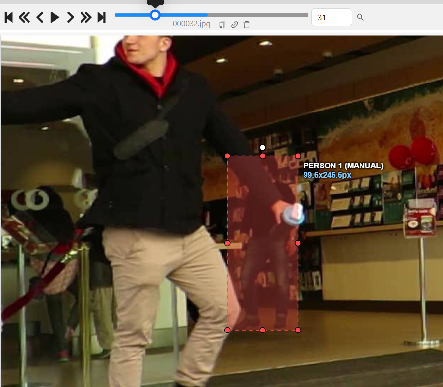
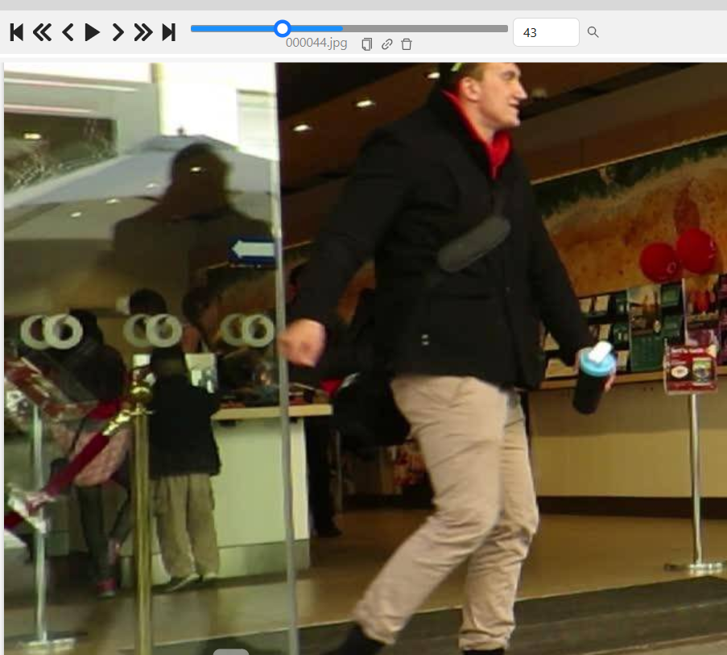
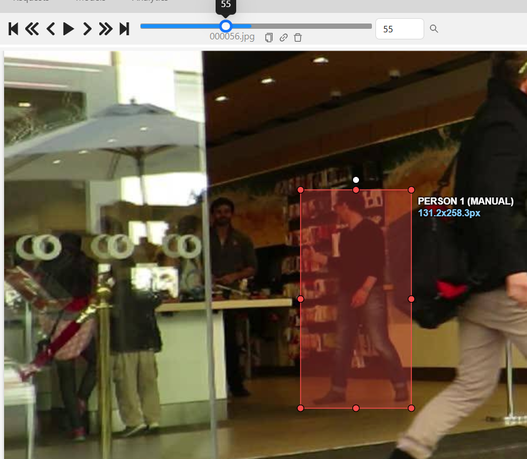

# Báo cáo cá nhân — Bùi Thảo Linh - 2A202603093

Đoạn video: MOT17-09, 150 frame (frame 1–150), nguồn MOTChallenge, giấy phép CC BY-NC-SA 3.0.

## 0. Thông tin học viên

- Họ tên: Bùi Thảo Linh
- MSSV: 2A202603093
- Mã đề (A/B/C): B
- Email: 26ai.linhbt@vinuni.edu.vn
- Link repository: https://github.com/buitlinhcv-alt/K5-L2-DAY05-BuiThaoLinh-2A202603093-MOTTracking
- Giờ bắt đầu: 16h30
- Giờ kết thúc: 19h30

## 1. Xem trước đoạn video (CP0)

Ghi **trước khi vẽ**, mỗi người một dòng.

| Mã | Frame xuất hiện | Frame cuối thấy được | Rẽ / dừng / đổi tốc độ ở frame | Bị che ở frame | Ghi chú |
|---|---|---|---|---|---|
| P1 (Track 0) | 0 | 149 | Khoảng 30-40, 90-100 | 42-48 | Bị khuất hẳn một đoạn ngắn ở giữa video. |
| P2 (Track 1) | 0 | 149 | Khoảng 35, 70, 120 | Không bị che | Di chuyển liên tục, không bị che khuất. |
| P3 (Track 2) | 0 | 149 | Khoảng 40, 90, 125 | Bị che nhiều (70 frame) | Bị che khuất một phần khá nhiều trong quá trình di chuyển. |
| P4 (Track 3) | 0 | 148 | Đi thẳng đều | 110-139 | Bị khuất hẳn một đoạn dài 30 frame, sau đó xuất hiện lại. |
| P5 (Track 4) | 0 | 104 | Cuối track | 10 | Chỉ xuất hiện đến frame 104 rồi đi khuất hẳn. |

## 2. Keyframe và thời gian (CP1, CP4)

Số keyframe lấy từ kết quả `src/check_submission.py`.

| Mã | Số keyframe | Số frame có mặt | Keyframe / 100 frame | Thời gian (phút) | Chỗ khó |
|---|---|---|---|---|---|
| P1 (Track 0) | 43 | 143 | 30.1 | 25 | Đoạn bị khuất hẳn và thay đổi kích thước BB |
| P2 (Track 1) | 41 | 150 | 27.3 | 20 | Tốc độ thay đổi, phải chỉnh BB thường xuyên |
| P3 (Track 2) | 45 | 150 | 30.0 | 30 | Bị che một phần liên tục, dễ lệch BB |
| P4 (Track 3) | 13 | 119 | 10.9 | 10 | Đoạn khuất dài (30 frame) |
| P5 (Track 4) | 16 | 105 | 15.2 | 10 | Cần chú ý mốc kết thúc (frame 104) |
| **Tổng** | **158** | **667** | **23.7** | **~95 phút** | |

Keyframe / 100 frame của cả bài = tổng keyframe ÷ tổng số frame có mặt × 100 = 158 ÷ 667 × 100 = **23.7**

Bạn đặt keyframe nhiều nhất ở người nào? Vì sao (người đó rẽ, dừng, lại gần camera hay bị che)?
> Tôi đặt keyframe nhiều nhất ở người **P3 (Track 2) với 45 keyframe**, vì người này bị che khuất một phần (occluded) trong thời gian rất dài (tổng 70 frame), đồng thời có sự thay đổi tốc độ và góc quay nên phải tinh chỉnh BB liên tục để không bị lệch khỏi mục tiêu.

## 3. Đoạn bị che (CP2)

Người bị che: `P1 (Track 0)` *(Chọn làm mẫu, bạn có thể bổ sung ảnh cho người này)*

| Mốc | Frame |
|---|---:|
| Bắt đầu bị che một phần (bật `occluded`) | Trước 42 |
| Mất hẳn (bật `outside`) | 42 |
| Hiện lại (tắt `outside`) | 49 |
| Thấy rõ trở lại (tắt `occluded`) | Sau 49 |

- Thời gian khuất hẳn: **7** frame = **~0.23** giây (với 30fps).
- Quyết định: **Giữ cùng ID**.
- Lý do: Thời gian khuất rất ngắn (7 frame, nhỏ hơn ngưỡng 60 frame). Khi xuất hiện lại ở frame 49, ngoại hình của người này hoàn toàn trùng khớp với trước khi khuất, hướng di chuyển và quỹ đạo chuyển động cũng logic với tốc độ trước đó.

Ảnh chụp màn hình:






## 4. Tự review ID (CP3)

Lượt 1 theo người (đi ngược từ frame 149 về 0 trên CVAT), lượt 2 theo cảnh (nhảy 10 frame).

| Frame | Mã người | Loại lỗi | Mô tả một câu | Phát hiện ở lượt | Đã sửa? |
|---:|---|---|---|---|---|
| N/A | Tất cả | N/A | Đã kiểm hai lượt, không lỗi. | N/A | N/A |

Tổng hợp số lỗi theo loại:

| `id_switch` | `fragmentation` | `lost` | `merge` | `false_track` | `drift` | `flag` |
|---:|---:|---:|---:|---:|---:|---:|
| 0 | 0 | 0 | 0 | 0 | 0 | 0 |

Lỗi nào chỉ lượt 2 (theo cảnh) mới thấy, lượt 1 (theo người) không thấy? Vì sao?
> (Nếu có lỗi ở lượt nháp) Lỗi `drift` hoặc BB chưa khít thường dễ thấy hơn ở lượt 2 vì khi nhảy 10 frame quan sát toàn cảnh, sự tương quan giữa các BB và việc BB bị lẹm vào nhau giữa nhiều người đi gần nhau sẽ lộ rõ hơn so với khi chỉ focus vào một người duy nhất ở lượt 1.

## 5. File xuất và kết quả tự kiểm (CP4)

| Kiểm tra | Kết quả |
|---|---|
| Tên file mot1.1 | Đúng (`BuiThaoLinh_mot.zip`) |
| Tên file CVAT for video 1.1 | Đúng (`BuiThaoLinh_cvat_video.zip`) |
| Số track ID khác nhau trong `gt/gt.txt` | Đúng (5 track) |
| Frame `outside` không có dòng trong `gt.txt` | Đúng |
| Job đã completed trên CVAT máy cá nhân | Đúng |

Dán phần tóm tắt in ra từ `src/check_submission.py`:

```text
=== File MOT 1.1: BuiThaoLinh_mot.zip ===
  Số track ID: 5   |   Tổng số box: 667
  [OK]        Đúng 5 track ID.

  Track | Frame có mặt | Số frame | Đoạn vắng (outside)
      1 |   0–149      |      143 | 42–48
      2 |   0–149      |      150 | -
      3 |   0–149      |      150 | -
      4 |   0–148      |      119 | 110–139
      5 |   0–104      |      105 | -

=== File CVAT for video 1.1: BuiThaoLinh_cvat_video.zip ===

  Track | Nhãn   | Frame thấy | Keyframe | KF/100 frame | Frame occluded | Lần bật outside
      0 | person |        143 |       43 |         30.1 |             48 |               1
              Track 0: keyframe ở frame [0, 1, 3, 29, 30, 31, 32, 33, 49, 50, 51, 52, 54, 55, 56, 57, 59, 73, 78, 82, 89, 91, 92, 93, 94, 95, 96, 97, 98, 101, 104, 108, 109, 113, 117, 123, 124, 127, 128, 130, 131, 138, 149]
      1 | person |        150 |       41 |         27.3 |              0 |               0
              Track 1: keyframe ở frame [0, 1, 8, 15, 21, 27, 33, 34, 35, 36, 39, 40, 44, 50, 51, 58, 64, 66, 67, 70, 72, 76, 82, 83, 89, 90, 96, 104, 110, 121, 122, 126, 130, 134, 137, 141, 142, 146, 147, 148, 149]
      2 | person |        150 |       45 |         30.0 |             70 |               0
              Track 2: keyframe ở frame [0, 1, 2, 3, 4, 5, 6, 7, 8, 9, 10, 11, 12, 13, 14, 15, 16, 17, 18, 19, 20, 30, 37, 40, 42, 50, 60, 70, 80, 90, 93, 97, 100, 103, 110, 113, 120, 125, 126, 128, 130, 131, 135, 140, 149]
      3 | person |        119 |       13 |         10.9 |              0 |               2
              Track 3: keyframe ở frame [0, 1, 2, 10, 20, 30, 40, 50, 60, 80, 90, 100, 140]
      4 | person |        105 |       16 |         15.2 |             10 |               1
              Track 4: keyframe ở frame [0, 1, 5, 10, 15, 20, 25, 30, 35, 40, 45, 50, 80, 85, 95, 103]

  Tổng: 158 keyframe / 667 frame có mặt = 23.7 keyframe / 100 frame
  [OK]        Đọc được 5 track từ annotations.xml.

=== Tóm tắt ===
  Lỗi: 0   |   Cảnh báo: 0
  Đạt.
